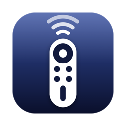
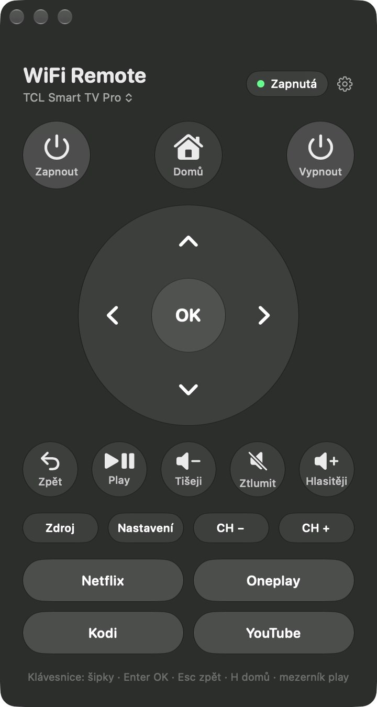

<p align="center">
  
</p>

<h1 align="center">WiFi Remote</h1>

<p align="center">
  A native macOS remote for Android TV and Google TV, over your Wi-Fi.<br>
  Finds your TV on its own, Liquid Glass design, desktop widgets, nothing to install on the TV.
</p>

<p align="center">
  <a href="https://github.com/Rarach28/wifiRemote/releases/latest"></a>
  
  
  
</p>

<p align="center">
  
</p>

---

## Features

- **Finds your TV by itself.** WiFi Remote searches the network for TVs with debugging turned on. You can
  also just type the TV's IP address.
- **Works with older and newer TVs.** Classic *network debugging* (port 5555), and Android 11+
  *wireless debugging* with a six-digit pairing code.
- **Power on and off**, Home, Back, D-pad with OK, play/pause, volume, mute, input, settings and channel keys.
- **App buttons you choose.** Pick any app installed on the TV, reorder them by dragging, rename them. Each
  button wakes the TV and opens the app.
- **Several TVs.** Save as many as you like and switch between them from the title.
- **Two desktop widgets**, each in small, medium and large sizes, working while the app is closed:
  - *Ovladač TV* (remote): power, Home, D-pad, volume, playback, input, settings and channel keys.
  - *Aplikace TV* (apps): your app buttons, 4, 8 or 14 of them depending on the size.
- **Keyboard control** while the window is in front: arrow keys, Return (OK), Esc (Back), H (Home),
  Space (play/pause).
- **Live status**: on, standby or unreachable.

> The app's interface is currently in Czech.

## Supported TVs

Any TV or streaming box running **Android TV or Google TV**: TCL, Sony, Philips, Xiaomi, Hisense (Android
models), Sharp, Chromecast with Google TV, Nvidia Shield and others.

Samsung (Tizen) and LG (webOS) TVs use different systems and are not supported.

## Install

1. Download **WiFiRemote-x.y.z.zip** from the [latest release](https://github.com/Rarach28/wifiRemote/releases/latest)
   and unzip it.
2. Move **WiFiRemote.app** to *Applications* and open it.
3. The app is signed but not notarized by Apple, so the first time macOS says it cannot verify it. Open
   **System Settings → Privacy & Security**, scroll down and click **Open Anyway** next to WiFi Remote.
4. Allow the requests that follow: *find devices on your local network* (to reach the TV) and the
   *background item* notice (the agent that serves the widgets).

On first launch WiFi Remote needs Google's `adb` tool. If your Mac has none (from Homebrew or Android Studio),
the app downloads the official [SDK Platform-Tools](https://developer.android.com/tools/releases/platform-tools)
from Google once, about 16 MB, into `~/Library/Application Support/WiFi Remote`.

Requires macOS 26 or later.

## Set up the TV

On the TV, unlock *Developer options*: **Settings → System → About**, press **Build** seven times. In
**Developer options** turn on **USB debugging**, then one of the following.

**Network debugging** (also called *ADB over network*; most Android TVs)

1. Turn on **Network debugging**.
2. In WiFi Remote open **Settings** (Nastavení). The TV appears under *Televize v síti*; click **Přidat**
   (Add). Or type its IP address.
3. The TV asks **"Allow debugging?"**. Tick *Always allow from this computer* and confirm.

**Wireless debugging** (Android 11 and newer, e.g. Chromecast with Google TV)

1. Turn on **Wireless debugging** and open **Pair device with pairing code**.
2. In WiFi Remote open **Settings** (Nastavení). The TV appears as *Čeká na párovací kód* (waiting for a
   code). Type the six-digit code shown on the TV and click **Spárovat** (Pair). Or type the IP address and
   port from the pairing screen yourself.

Then choose the app buttons under **Nastavení → Tlačítka** (Settings → Buttons).

You can find the TV's IP address under **Settings → Network & Internet** on the TV.

## Add the widgets

Right-click the desktop, choose **Edit Widgets** and search for **WiFi Remote**. Drag *Ovladač TV* (the
remote) and/or *Aplikace TV* (the app buttons) onto the desktop in the size you like. Both follow the TV
and buttons selected in the app.

## Build from source

Requirements: Xcode 26 or later, [XcodeGen](https://github.com/yonaskolb/XcodeGen) (`brew install xcodegen`)
and an *Apple Development* signing certificate (a free Apple account signed in to Xcode is enough; macOS
only loads widgets from a signed extension).

```sh
git clone https://github.com/Rarach28/wifiRemote.git
cd wifiRemote
./build.sh               # build and install in ~/Applications
./build.sh --release     # build a universal zip for a release (build/WiFiRemote-<version>.zip)
```

## How it works

```
 Window ─┐
         ├── HTTP on 127.0.0.1 + token ──▶  Agent  ──▶  adb  ──Wi-Fi──▶  TV
 Widget ─┘                                (login item)
```

- **Agent.** The app registers a small login agent (`WiFiRemote --agent`, via `SMAppService`) that drives
  Google's `adb`. It listens on `127.0.0.1` only and refuses any request without a random token created on
  first launch and shared with the widgets through the app group.
- **Widgets.** Widgets run in the macOS sandbox and cannot open ADB connections themselves. Their buttons
  are App Intents that pass each key to the agent.
- **Commands.** The agent accepts a fixed set of named keys and package names only, never arbitrary shell
  commands.
- **Discovery.** The TV list combines mDNS (`_adb._tcp`, `_adb-tls-connect._tcp`, `_adb-tls-pairing._tcp`)
  with a quick sweep of the local network for port 5555.
- **Wireless debugging** moves to a new port when it is turned on again or the TV restarts. The agent finds
  the new port over mDNS by itself.
- **ADB key.** `adb` uses its usual key in `~/.android/adbkey`, so a TV that already trusts this Mac does
  not ask again.

## Security

Debugging gives full control of the TV to any computer whose key the TV has accepted. Only accept the
prompt for your own computer, and turn debugging off on the TV when you no longer need the remote.

## Uninstall

1. Quit WiFi Remote. In **System Settings → General → Login Items & Extensions**, turn off **WiFi Remote**.
2. Delete **WiFiRemote.app**.
3. Optionally delete `~/Library/Application Support/WiFi Remote` (the downloaded Platform-Tools).

## Project layout

| Path | Contents |
| --- | --- |
| `App/` | The app: remote window, settings, login agent, adb, network search |
| `Widget/` | Desktop widgets and their App Intents |
| `Shared/` | Agent client and shared settings used by both the app and the widgets |
| `Agent/` | launchd property list for the login agent |
| `icon.swift` | Draws the app icon |
| `project.yml` | XcodeGen project spec |
| `build.sh` | Build, sign, install or package a release |

## License

[MIT](LICENSE)
